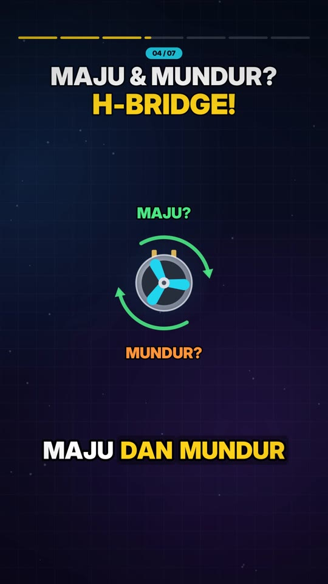

# Video Reels/TikTok: "Apa itu Motor Driver?"



**File video:** [`motor-driver-explainer.mp4`](motor-driver-explainer.mp4)
1080×1920 (9:16) · 30 fps · 79 detik · H.264 + AAC 256 kbps · audio -14 LUFS / puncak -1.2 dBFS (standar loudness TikTok/IG)

## Alur cerita
| # | Adegan | Isi |
|---|--------|-----|
| 1 | Hook | Motor dicolok langsung ke Arduino → nggak muter → Arduino kena *ZAP*, rusak. Jawabannya: **MOTOR DRIVER** |
| 2 | Masalah | Grafik batang: pin Arduino ±20 mA vs motor DC sampai 2000 mA (100x lipat), lalu pin jebol |
| 3 | Solusi | Arduino kirim sinyal kecil → motor driver mengalirkan arus besar dari baterai → motor. Arduino = **otak**, driver = **otot** |
| 4 | H-Bridge | 4 saklar berbentuk huruf H; S1+S4 tertutup → motor putar kanan, S2+S3 → putar kiri |
| 5 | PWM | Osiloskop menampilkan gelombang ON/OFF, duty naik 15%→95%, motor makin kencang |
| 6 | Contoh | L298N (±2A), L293D (±0.6A), TB6612FNG (±1.2A, efisien) |
| 7 | Penutup | Ringkasan otak vs otot + animasi tombol Follow |

## Desain suara
- **Narator:** suara Bahasa Indonesia (`id-ID-ArdiNeural`), diberi EQ presence + kompresi supaya jelas di speaker HP.
- **Musik:** beat elektronik 112 BPM disintesis langsung (Am–F–C–G: kick, clap, hi-hat, bass, pluck arp, pad + reverb), pakai **sidechain ducking** otomatis tiap narator bicara, dan **sengaja mati sesaat** di momen "rusak" lalu masuk lagi dengan impact.
- **SFX (semua disintesis, bebas hak cipta):** boom/impact, whoosh tiap transisi, pop saat objek muncul, setrum *zap* + crackle, alarm, tick counter yang nadanya naik, klik saklar, data chirp sinyal, power-up, chime, shimmer, riser sebelum klimaks.
- **Suara motor realistis:** dengung + sikat (brush noise) yang **pitch-nya mengikuti kecepatan putaran di layar**, plus PWM whine yang berubah sesuai duty cycle.

## Caption siap posting
> Kenapa motor DC nggak bisa langsung dicolok ke Arduino? 🤔⚡ Kenalan sama MOTOR DRIVER, si "otot" dari robotmu 💪
> Simpan biar nggak lupa & share ke temanmu yang lagi belajar robotik!
>
> #arduino #elektronika #robotik #motordriver #hbridge #pwm #belajarelektronika #iot #mikrokontroler #fyp #edukasi #stem

## Build ulang
```bash
pip install edge-tts pycairo numpy scipy
./build.sh
```
Naskah ada di `script.py`, timing di `timeline.py`, visual di `render.py`, audio di `audio.py`.
